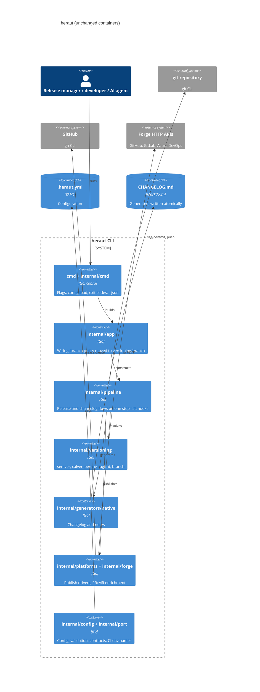
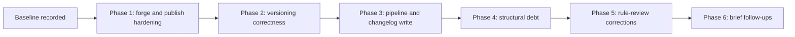

# Modernization Brief: heraut

Date: 2026-10-22. Status: **approved (full plan) on 2026-10-22.** This revision replaces the brief approved on 2026-10-14; that version is kept unchanged as `MODERNIZATION_BRIEF.2026-10-14.md`.

Inputs read: `INTENT.md`, `PREFLIGHT.md`, `ASSESdomain-expertNT.md`, `SECURITY_FINDINGS.md`, `topology.json` (with the `.mmd` files), `BUSINESS_RULES.md`, `RULE_REVIEWS.json` and the three roadmaps (`docs/tasks/hardening-roadmap.md`, `hardening-2-roadmap.md`, `hardening-3-roadmap.md`). **File times are not usable as input dates:** every artifact in `analysis/heraut/` shows 2026-10-21 16:15, because the commit hooks' stash-and-restore step touched the untracked files. By content: `ASSESdomain-expertNT.md`, `topology.json`, `BUSINESS_RULES.md` and `SECURITY_FINDINGS.md` date from 2026-10-14 (with dated notes to 2026-10-15) and describe the code as it was at `71acdc5`; `RULE_REVIEWS.json` was completed on 2026-10-20. `DELTA_CATALOG.md` is not needed: this is not a version move.

## 1. Objective
heraut is a young, well-layered Go 1.27 CLI that cuts releases for GitHub and GitLab. You asked to understand it first, with two conditions: fix known bugs as we go, and review security first. The assessment found no case for a migration, a rewrite or a rebuild and recommended an **in-place Refactor**, so none of `uplift`, `transform` or `reimagine` applied. That plan has been carried out on `main`: the four phases of the approved brief (T380–T401), then two follow-up epics the work itself produced, one from reviewing the 63 rules that nobody had reviewed (T402–T409) and one for the structure items the brief left open (T410–T412). This revision records the outcome, ticks the criteria the evidence supports, and lists what is still yours to decide. There is no remaining build phase.

## 2. Target Architecture
The architecture did not change. The hexagonal layering held throughout (no upward imports); the layer table in `.claude/rules/coding.md` now matches the real imports. The containers are the ones of the original brief.



| Legacy component | Target | Outcome |
|---|---|---|
| `cmd/heraut` | same | Layer rule amended instead of the code (T395, your choice): the entry point may import `ui` |
| `internal/cmd` | same | Flag-read errors handled through `flagReader` (T392); `runRelease` and `runInit` extracted; `version next` and `release` now reject a non-canonical CalVer `--set-version` (T406) |
| `internal/app` | same | Branch rules and guards moved to the new `internal/versioning/branch`, git origin lookup to `forge.GitOriginURL` (T396); rotation, tickets and pre-release detection stay, because no allowed package can own them |
| `internal/pipeline` | same | One step list (`steps.go`) drives `Run`, the dry run, `Plan` and `heraut changelog` (T390, T401); hook variable contract documented (T388); hook `stage` with no changelog commit is a config error or a warning (T407); a gate refusal is now shown to the user |
| `internal/versioning/*` | same | Highest parsed tag wins for CalVer and `calver-per-env`, UTC dates, `--set-version` always probes for an existing tag (T383–T386, T399); strict SemVer parts (T402); build IDs and `--env` restricted (T400); an empty-changelog warning (T408) |
| `internal/generators/native` | same | Atomic changelog write (T387); `security` is a built-in commit type and the body heuristic is gone (T404) |
| `internal/platforms/*`, `internal/forge/*` | same | `https` required except loopback, redirect token headers dropped, asset paths confined to the repo and checked before anything is pushed (T380–T382, T398); a pattern matching no file is refused unless `release.allow_missing_assets` (T409) |
| `internal/config` | same | `validator.go` split into 7 files (T391); host URLs defined once (T393); CI and token env names defined once (T411); deterministic validation error order (T403); sprint bump confined to the `versioning:` block (T405) |
| `internal/scaffold` | same | `wizard.go` split into `wizard.go`, `answers.go`, `decisions.go`, `platform_wizard.go` (T397, T412); git origin read through the runner (T410) |
| `testutil`, `e2e`, `port`, `exitcode`, `skill`, `conventionalcommit`, `ui` | unchanged | `ClearCIEnv` now clears every CI variable production code reads |

## 3. Phased Sequence
The phases were sequenced by risk and by which rule decisions they waited on, not by strangler-fig or build-graph order, and Phase 1 was a pilot. What the pilot and the later phases surfaced did revise the plan, as this brief predicted: the asset-glob preflight (T398) and the CalVer `CurrentTag` fix (T399) were added mid-flight, and T400 and T401 came out of T388 and T390. Phases 5 and 6 are the two follow-up epics. They sit in the same shape so the progress pane can read them. Module ids are those of `topology.json` as of 2026-10-14; the package `internal/versioning/branch` created in T396 is not in it, and re-running `map` would add it.

**Command line:** none of the three build commands covers an in-place refactor. Each phase says `Command: none` and ran through heraut's own workflow: roadmap tasks, TDD (failing test first), one task per session, conventional commits on `main`.

You steer execution by editing this file. An edited criterion is honored; a chat message is not. A build step may tick a box or add a note, but never rewrites a criterion: a proposed change goes on a `Proposed revision:` line for you to approve. In this revision I ticked each box that a commit, a roadmap completion note or a test run backs, and wrote the evidence beside it; untick any you do not accept.



#### Phase 1 — Forge and publish hardening
Command: none (in-place fixes through the roadmap, TDD)
Modules: internal/forge/gitlab, internal/platforms, internal/platforms/gitlab, internal/config
Scale: S
Risk: Low-Medium; (1) rejecting `http://` base URLs breaks users on internal HTTP GitLab: loopback is allowed and the policy is explicit; (2) confining asset globs to the repo root breaks users who publish from outside it.
Entry criteria:
- [x] Baseline recorded in `analysis/heraut/BASELINE.md` (`mise run test` result, e2e Lane A result, coverage figure)
- [x] Tasks for SEC-003, SEC-004 and SEC-009 added to the roadmap as `[ ]` (T380–T382, `docs/tasks/hardening-roadmap.md`)
- [x] Pilot unit named: `internal/forge/gitlab` (SEC-003, redirect token headers)
Exit criteria:
- [x] A failing-then-passing test exists for each of SEC-003, SEC-004 and SEC-009
  Evidence: T380 (`f826273`, `ba4b684`), T381 (`1868679`), T382 (`5651dd1`); T398 added the pre-push asset check that closed the SEC-009 residual.
- [x] `mise run test` and e2e Lane A pass, coverage gate 85% holds
  Evidence: suite green and total coverage 88.4% on 2026-10-21.
- [x] `sameGitLabHost` compares scheme and host (`platform.go:170`)
- [x] Asset paths that resolve outside the repo root are refused (`internal/platforms/globs.go`, T382)
- [x] Roadmap tasks flipped to `[x]` with their notes

#### Phase 2 — Versioning correctness
Command: none (in-place fixes through the roadmap, TDD)
Modules: internal/versioning/calver, internal/versioning/perenv, internal/versioning/semver, internal/versioning/tagfmt, internal/versioning
Scale: M
Risk: High; (1) versions and tags are irreversible once pushed: every change was pinned by characterization tests first; (2) CalVer and per-env changes alter tags users already have: the wanted behavior was decided before coding.
Entry criteria:
- [x] Phase 1 exit criteria met
- [x] RULE-007, RULE-008 and RULE-046 each have a written "wanted behavior" in section 7
- [x] Characterization tests recorded for the current CalVer latest-tag choice on `YYYY.MM.PATCH`, `YYYY.WW.PATCH` and one SPRINT-first format
Exit criteria:
- [x] SEC-001's `latestTag` path returns only a tag that parsed (T383, `b28ce7b`)
- [x] RULE-008 and RULE-046 fixed per the wanted behavior, each with a failing-then-passing test (T384, T386; RULE-007 by T385)
- [x] All confirmed P0 rules for versioning still pass their existing tests (suite green)
- [x] No test row deleted unless an ADR documents the change (ADR-0073, ADR-0074, ADR-0075 and ADR-0076 cover the deliberate changes)

#### Phase 3 — Pipeline and changelog write
Command: none (in-place fixes through the roadmap, TDD)
Modules: internal/pipeline, internal/generators/native, internal/conventionalcommit
Scale: L
Risk: High; (1) the release flow is irreversible past the tag push: the dry-run path now shares the real path's step list, pinned by an equivalence test; (2) the hook contract was decided (document, do not quote) before coding.
Entry criteria:
- [x] Phase 2 exit criteria met
- [x] RULE-055 and RULE-058 decided, recorded in `RULE_REVIEWS.json`
- [x] Hook variable contract documented (hook author quotes; CI must not run hooks from an untrusted PR's config)
Exit criteria:
- [x] The hook variable contract and the untrusted-config warning are documented, with a real-`sh` test (T388, `0db53b1`)
- [x] Changelog write is atomic with a test for an interrupted write (T387, `d42b755`)
- [x] `Pipeline.Run` is split into named steps and the dry-run path no longer discards errors with `_ =` (T390, `cb9adc2`, `1ad6f7b`)
- [x] A failure-recovery guide exists, verified against the GitHub and GitLab sandbox repos, and states what cannot be undone (T389, `docs/guides/failure-recovery.md`)
- [x] RULE-057, 059..062 and 067 still pass; the `--json` plan still matches the executed steps (`plan_equivalence_test.go`)

#### Phase 4 — Structural debt
Command: none (in-place refactors through the roadmap, TDD)
Modules: internal/config, internal/app, internal/cmd, internal/scaffold, internal/forge, internal/platforms, cmd/heraut
Scale: XL
Risk: Medium; (1) the three large files have many callers: split by moving code only; (2) renaming config structs is a breaking change: wire names untouched.
Entry criteria:
- [x] Phase 3 exit criteria met
- [x] Coverage figure from the baseline still met on `main`
Exit criteria:
- [x] `validator.go` split by concern with `ValidationErrors` unchanged (T391, `4cd30e9`)
- [x] The 64 ignored flag-read errors handled (T392, `28134f4`)
- [x] GitHub and GitLab host URLs defined once (T393, `d21013e`)
- [x] `origin` remote documented as a limit (T394: Spec 03 "The remote is always `origin`", your choice over a config field)
- [x] `.claude/rules/coding.md` layer table matches the real imports (T395; amended again for `testutil` → `config` in T411)
- [x] `schema.json` and `docs/heraut.sample.yml` still in sync with `internal/config/config.go` (schema fixtures pass; `allow_missing_assets` added to both in T409)

#### Phase 5 — Rule-review corrections
Command: none (in-place fixes through `docs/tasks/hardening-2-roadmap.md`, TDD)
Modules: internal/versioning/semver, internal/config, internal/generators/native, internal/app, internal/pipeline, internal/platforms
Scale: M
Risk: Medium; (1) four tasks change what users see (`--set-version` under CalVer, hook `stage`, the empty-changelog warning, asset patterns): each started with an ADR or addendum you accepted; (2) a pattern that matches nothing now fails earlier than before: `release.allow_missing_assets` restores the old behavior.
Entry criteria:
- [x] All 72 rules carry a person's verdict in `RULE_REVIEWS.json` (60 confirmed, 12 wrong, 0 open)
- [x] Each "wrong" rule has a written decision in `RULE_REVIEWS.json`
Exit criteria:
- [x] RULE-002, 016, 013, 015 fixed (T402–T405), each test-first; RULE-013 after ADR-0075
- [x] RULE-032, 065, 052, 039 fixed (T406–T409), after the ADR-0074 and ADR-0061 addenda and ADR-0076 (RULE-052 needed none)
- [x] Suite, e2e Lane A and lint green; coverage not below 88%

#### Phase 6 — Brief follow-ups
Command: none (in-place refactors through `docs/tasks/hardening-3-roadmap.md`, TDD)
Modules: internal/scaffold, internal/forge, internal/pipeline, internal/platforms, internal/config
Scale: S
Risk: Low; all three tasks are behavior-preserving, pinned by characterization tests.
Entry criteria:
- [x] Phase 5 exit criteria met
Exit criteria:
- [x] The wizard reads the git origin through the runner (T410, `03f60b7`)
- [x] CI and token env var names are defined once in `internal/config` (T411, `77fe08e`..`72b791f`), and `ClearCIEnv` clears every one production code reads
- [x] `runPlatformWizard` is a short loop over step functions (T412, `a40ae7b`)

## 4. Business Walkthroughs
These are the four flows mapped in `TOPOLOGY.html`. They were derived from the code by me, not confirmed with a person.

| Flow | Persona | What happens | Legacy modules | Phases that touched it |
|---|---|---|---|---|
| Cut a release | Release manager | Runs `heraut release`; gets a version, changelog, tag and published release | `internal/cmd`, `config`, `app`, `versioning`, `versioning/semver`, `generators/native`, `pipeline`, `platforms/github`, `platforms/gitlab` | 1 (publish), 2 (versions), 3 (pipeline, changelog), 4, 5 (assets, `--set-version`) |
| Write a store changelog | Mobile release engineer | Prints a tag's notes as plain text for a store submission | `internal/cmd`, `app`, `versioning/semver`, `generators/native` | 3 (changelog write), 5 (Security section) |
| Validate a commit message | Developer | The commit-msg hook runs `heraut commit verify` | `internal/cmd`, `conventionalcommit`, `app`, `config` | 4 (validator split), 5 (`security` is a valid type) |
| Let an AI agent plan a release | AI coding agent | Installs the skill, checks readiness, reads the JSON plan | `internal/cmd`, `skill`, `app`, `config`, `pipeline`, `versioning` | 3 (plan equals the run), 5 (warnings in the plan) |

## 5. Behavior Contract
The P0 rules are the regression suite: there are 36 of them, and all 36 now carry a person's verdict. The existing 183 test files plus e2e Lane A exercise them on every run.

**Confirmed by a person (30 P0):** RULE-001, 003, 004, 005, 006, 009, 010, 011, 018, 020, 027, 029, 031, 040, 041, 042, 044, 045, 047, 048, 050, 051, 055, 057, 058, 059, 060, 061, 062, 067. (RULE-055 and RULE-058 are documented-behavior decisions: hook values stay unquoted; no rollback, a recovery guide instead.)

**Ruled wrong, then fixed and now in the contract (6 P0):** RULE-002 (strict SemVer parts, T402), RULE-007 (UTC, T385), RULE-008 (highest tag, T384, T399), RULE-016 (stable error order, T403), RULE-046 (probe for an existing tag, T386), RULE-069 (atomic write, T387).

**P1 and P2 rules (36):** 30 confirmed and 6 ruled wrong and fixed (RULE-013, 015, 032, 039, 052, 065). All 12 "wrong" verdicts across priorities are implemented.

Blockers needing domain-expert confirmation: none. No rule is marked `discuss`.

## 6. Validation Strategy
This is the same code base, so there is no second implementation to diff against. `/code-modernization:modernize-verify` does not apply: it judges code built into `modernized/`, which does not exist, and `legacy/` has changed by design. See the open question in section 7.

| Phase | Validation actually used |
|---|---|
| Baseline | `mise run test`, e2e Lane A and coverage recorded in `BASELINE.md` (88.1% at `71acdc5`) |
| 1 | Unit and contract tests (`httptest.Server` for GitLab, `MockRunner` for CLI calls); one new failing test per finding |
| 2 | Characterization tests of the old tag output first, then table tests; existing edge-case rows untouched |
| 3 | Equivalence tests (dry run, `Plan` and `Run` on one step list; `changelog` likewise), a real-`sh` hook test, an interrupted-write test, and the recovery commands run on the GitHub and GitLab sandbox repos |
| 4 | Move-only refactors under the existing suite; coverage gate 85%; schema fixtures in `testdata/config/` |
| 5 | An ADR or addendum first for every behavior change; unit, pipeline and e2e Lane A tests per rule |
| 6 | Characterization tests before each refactor |
| All | Suite, e2e Lane A and lint at every commit; total coverage 88.4% on 2026-10-21 (gate 85%); you reported running the end-to-end suite after the push (its result is not recorded here). Lane B (forge sandbox) only on request |

**What this does not prove:** behavior the tests do not pin. Test names do not cite rule ids, so which tests cover which rule is not measured; I have not run `trace_rules.py` on the repo's own tests. The forms of the `init` wizard have no test (they need a terminal), only the decisions behind them.

## 7. Open Questions
Each is a decision for you.

- [x] **Approach.** In-place Refactor through heraut's own roadmaps. Approved 2026-10-14.
- [x] **RULE-007, 008, 046, 069, 055, 058.** Decided on 2026-10-14 (UTC; highest parsed tag; probe for an existing tag; atomic write; document hook quoting; document recovery) and implemented.
- [x] **Recovery guide: verify before writing.** Done in T389 on the sandbox repos. Still unverified: where `gh` picks the URL scheme under `GH_HOST` (GitHub Enterprise), and the `pre_release`-hook failure path, which comes from the spec, not from a run.
- [x] **Review the 27 unreviewed P0 rules.** Done 2026-10-16: all 72 rules reviewed (60 confirmed, 12 wrong).
- [x] **Security evidence gaps.** Client-go's redirect handling was checked in T380. Git history scanned 2026-10-14: no secrets.
- [x] **Layer rules.** Amended to match the code (T395). **`origin` remote:** documented as a limit (T394).
- [x] **Decisions taken in the follow-up epics** (all recorded as ADRs or addenda): ADR-0074 build IDs, `--env` and a canonical CalVer `--set-version`; ADR-0061 addendum on `stage`; ADR-0075 `security` as a built-in commit type; ADR-0076 asset patterns must match a file.
- [ ] **Verification of an in-place refactor.** `modernize-verify` cannot judge it. Your answer (2026-10-22): the proof is not enough as it stands; the e2e suite should be updated first for the changes made. Audit of the gaps (Lane A has no scenario for): a canonical CalVer `--set-version` (T406); the `--set-build-id` character set and `--env` under `semver`/`calver` (T400); the `security` commit type in a changelog and in `commit verify` (T404); a changelog write refused in a read-only directory (T387); the `calver-per-env` highest-tag choice (T384, T399); `version sprint bump` with a comment on the `versioning:` line (T405); and a Lane B run of the asset gate on the real forges. **Open:** scope and roadmap for that work (a proposed Phase 77); nothing is written yet.
- [x] **Security re-scan.** Done 2026-10-22 (see `SECURITY_FINDINGS.md`): no Critical or High; SEC-001, 003, 004, 005, 009 resolved; one new Low (NEW-001: the GitHub and Azure enrichment clients have no `CheckRedirect`, so an https to http downgrade would send the token in clear) and four Info items. The Go standard library issue GO-2026-6809 (go1.27.2, fixed in go1.27.3) is known to the CI workflow and left to the agent that bumps the toolchain. **Still open:** whether NEW-001 (and optionally NEW-005, NEW-003) go on a roadmap.
- [x] **Topology and assessment are stale.** `map` re-run 2026-10-22 and `assess` re-run 2026-10-22 (the 2026-10-14 copy is kept as `ASSESdomain-expertNT.2026-10-14.md`): size 21.1k production lines, 0 layer violations, `govulncheck` clean, pattern unchanged (in-place Refactor, essentially complete).
- [x] **Unscheduled items.** Decided 2026-10-23: padded CalVer `PATCH`, a per-pattern `optional` marker for assets and the lenient `Atoi` in `rotation.go` are dropped, with no task.
- [x] **Security candidates.** Decided 2026-10-23: NEW-001 and NEW-005 are scheduled as T419 and T420 (Phase 78, `docs/tasks/hardening-5-roadmap.md`). NEW-003 and NEW-004 were scheduled later the same day as T421 and T422 (Phase 79, `docs/tasks/hardening-6-roadmap.md`); both are done 2026-10-24 (`04767e7`, `45ddc9a`). NEW-002 stays deferred until `gh` is replaced by an in-process client.
- [x] **Untracked files.** Decided 2026-10-22: `analysis/`, `legacy/` and `.claude/worktrees/` stay uncommitted, and are not added to `.gitignore`. Revised 2026-10-24: a snapshot of the brief, the rules, the reviews and the security findings is kept in `docs/audit/`; `legacy/` and `.claude/worktrees/` are now ignored.
- [x] **Close the effort?** Closed 2026-10-24 (your answer "yes", after Phase 78). Final state: Phases 73 to 78 complete (T391 to T420), including NEW-001 (T419) and NEW-005 (T420); `assess` and `map` re-run; `SECURITY_FINDINGS.md` updated in place; `go test ./...` passes. Recorded: Lane B asset scenarios (T418) were run on 2026-10-24 together with the whole Lane B suite (B1 to B10, GitHub and GitLab, all passing, sandboxes left clean). Not done and recorded: `modernize-verify` not applicable (nothing under `modernized/`); `GH_HOST` scheme handling in `gh` unverified, and the recovery guide's hand recovery after a skipped `pre_release` target not exercised (the skip itself is covered by an e2e test, `e2e/release_flow_test.go`); NEW-002 deferred until `gh` is removed (NEW-003 and NEW-004 were fixed afterwards in Phase 79, T421–T422); padded `PATCH`, an `optional` asset marker and the `rotation.go` `Atoi` dropped. Local commits were pushed by you on 2026-10-24.

## 8. Approval Block

```
Approved by: bchatard (in chat)  Date: 2026-10-22
Approval covers: Full plan
```

Previous approval (2026-10-14, bchatard, full plan) covered the original four phases; it is recorded in `MODERNIZATION_BRIEF.2026-10-14.md`. This revision was approved separately on 2026-10-22; the four open questions in section 7 (verification, `assess`, unscheduled items, closing the effort) stay open and are decided where they are listed.
