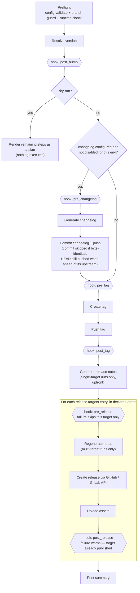
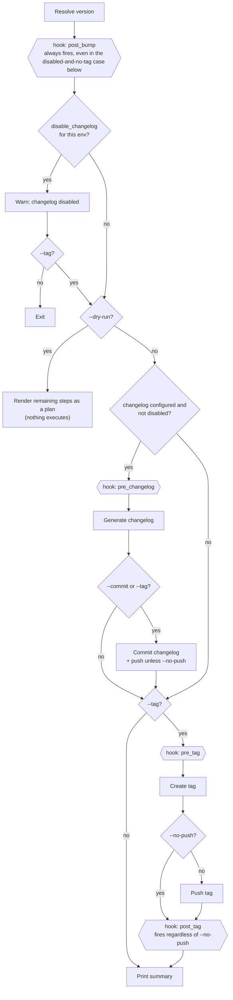

# Run your own steps during a release

Hooks run your own commands at fixed points of a release: write the new version into another file,
build or test before tagging, publish a package after the tag, send a message once the release is
out.

```yaml
hooks:
  post_bump:
    - run: "npm version {{ .Version }} --no-git-tag-version"
      stage: [package.json]          # commit this file with the changelog
  pre_tag:
    - run: "make test"
  post_tag:
    - run: "npm publish"
  post_release:
    - run: "curl -X POST \"$SLACK_WEBHOOK\" -d 'Released {{ .Tag }} on {{ .Platform }}'"
```

Each hook point takes a list of steps, run in order. A step is an object with `run`, the command,
and for two points `stage`, the files it changes (see below).

## Where each hook runs

### `heraut release`



Hooks are the hexagons. `--dry-run` runs none of them: it prints each command as it would run, with
the values filled in.

### `heraut changelog`



`pre_release` and `post_release` never run here, since `heraut changelog` publishes nothing.

## The hook points

| Point | Runs |
|---|---|
| `post_bump` | Right after the version is known, every time, even in a run that will change nothing else. |
| `pre_changelog` | Before the changelog is written, when one is written this run. |
| `pre_tag` | Before the tag is created, when one is created this run. |
| `post_tag` | After the tag is pushed, and also with `--no-push`. |
| `pre_release` | `heraut release` only: before publishing, once per target. |
| `post_release` | `heraut release` only: after publishing (and uploading files), once per target. |

## Values you can use

Commands are templates: heraut fills these in before running them.

| Value | Example | Available in |
|---|---|---|
| `{{ .Version }}` | `1.2.3` | every point |
| `{{ .Tag }}` | `v1.2.3` | every point |
| `{{ .PreviousTag }}` | `v1.2.2`, empty for the first release | every point |
| `{{ .Env }}` | the `--env` value, empty without one | every point |
| `{{ .Platform }}` | the target's name, e.g. `github` | `pre_release`, `post_release` |

They are Go templates, so one command can branch:
`{{ if eq .Env "prod" }}./deploy.sh{{ end }}`.

## Commit the files a hook changes

A file a hook writes is not committed unless you say so. List it under `stage`, and heraut adds it to
the release commit, next to `CHANGELOG.md`:

```yaml
hooks:
  post_bump:
    - run: "echo {{ .Version }} > VERSION"
      stage: [VERSION]
```

- `stage` works on `post_bump` and `pre_changelog` only, the two points before the release commit.
  On any other point it is a configuration error.
- A pattern that matches no file stops the run.
- In a run that makes no release commit (no changelog, `disable_changelog`, a pre-release,
  `heraut changelog` without `--commit`), the command still runs and its files stay uncommitted,
  with a warning. When no run of the configuration can make that commit, `stage` is a configuration
  error.

## When a hook fails

A failing hook stops the run, and what already happened stays: a release commit pushed before a
failing `pre_tag` hook stays pushed. [Recover from a failed release](failure-recovery.md) says how to
finish.

`pre_release` and `post_release` are the exception, because they run once per target. A failing
`pre_release` skips that target only; a failing `post_release` is reported, but the release is
already out. heraut still tries the other targets, then exits with an error.

## Skip hooks for one run

```bash
heraut release --no-hooks                  # skip them all
heraut release --skip-hook pre_tag         # skip one point (repeatable, or comma-separated)
HERAUT_SKIP_HOOKS=pre_tag,post_tag heraut release
```

`--skip-hook` wins over `HERAUT_SKIP_HOOKS`, and `--no-hooks` over both. `heraut changelog` accepts
the four points it runs.

## Quoting, and configs you didn't write

Values are pasted into the command as they are, then the shell reads it. Quote a value that could
hold a space or shell syntax: `notify '{{ .Tag }}'`. Single quotes keep it inert; double quotes still
run a `$(…)` inside it.

A hook runs with the permissions of whoever runs heraut, CI tokens included. **Never run heraut with
hooks from a `.heraut.yml` you haven't reviewed**, such as the one in a pull request from a fork. Run
it with the base branch's configuration, or pass `--no-hooks`.

## Which shell

Commands run with `sh -c` on Linux and macOS, and with `cmd` on Windows. Write them for the shell of
the machine that runs the release; heraut doesn't translate between the two. A hook's output shows
as it runs.
